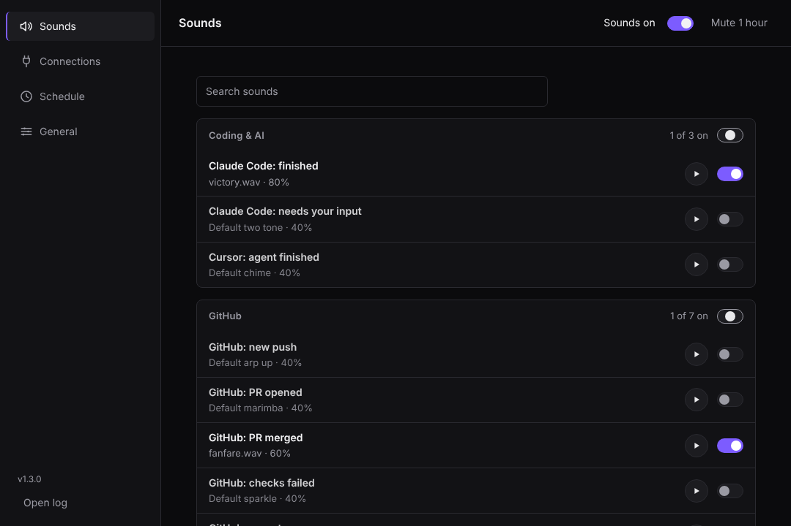

<div align="center">
  
  <p><strong>Plays a sound when your AI tools, builds or downloads finish, so you can stop checking.</strong></p>
  <p>
    <a href="https://github.com/dennycrafter/Noizes/actions/workflows/build.yml"></a>
    <a href="https://github.com/dennycrafter/Noizes/releases"></a>
    
    <a href="LICENSE"></a>
  </p>
</div>

## What is it?

You ask Claude, Cursor or a build to do something that takes a few minutes. You switch to another window. Then you keep flicking back to see if it's done.

Noizes fixes that. It sits in your Windows system tray and plays a short sound the moment something finishes. You pick which things make a sound and which sound each one makes.

It runs only on your PC. No account, no cloud, no tracking.

<div align="center"></div>

## What it can tell you about

| Group | Sounds for |
|---|---|
| **Coding and AI** | Claude Code finished, Claude Code needs your input, Cursor agent finished |
| **Apps** | Claude desktop app finished a reply |
| **Browser** (needs the Chrome extension) | claude.ai finished, Obvious finished, a tab you're watching finished, a download finished |
| **GitHub** | New push, PR opened, PR merged, checks failed, new star, new issue, new comment |
| **Deploys** | Deploy succeeded, deploy failed |
| **Extras** | A website went down, a long terminal command finished, countdown at 1 hour / 30 min / 10 min |

Every sound starts **off** on a fresh install, at 40% volume. You turn on only what you want.

## Install

1. Go to [Releases](https://github.com/dennycrafter/Noizes/releases) and download `Noizes-<version>-setup.exe`.
2. Run it. No admin rights needed.
3. Noizes opens and an icon appears in your system tray (bottom right, near the clock).
4. Double-click the tray icon to open Settings and switch on the sounds you want.

Upgrading? Just run the new installer. It closes the old Noizes for you and keeps your settings.

### Optional: hook up Claude Code and Cursor in one step

Open a new terminal and run:

```
noizes setup
```

This connects Claude Code and Cursor and turns on four sounds: Claude Code finished, Claude Code needs input, Cursor finished, and long command finished. It's safe to run more than once.

### Optional: the Chrome extension

Needed for the Browser sounds. In Noizes, go to **Settings → Connections → Chrome extension** and follow the four steps. There's a button that opens the extension folder for you.

## Using it

- **Tray icon:** double-click to open Settings. Right-click for Settings, Mute, Mute for 1 hour, Start with Windows and Exit. The icon shows a slash while muted.
- **Sounds page:** a switch on every row. Pick a different sound or volume per event.
- **Connections page:** GitHub, Claude Code, Cursor, the Claude desktop app and Chrome.
- **Schedule page:** quiet hours (off by default; 22:00 to 07:00 when on). Alarms like "site down" can still play.
- **Mute:** "Sounds off" and "Mute 1 hour" sit at the top of every page.

Changes save as soon as you click. There is no Save button.

## Terminal commands

| Command | What it does |
|---|---|
| `noizes setup` | Connects Claude Code and Cursor and turns on the four core sounds |
| `noizes run <command>` | Runs your command and plays a sound when it ends, if it took over 30 seconds |
| `noizes test [event]` | Plays a sound right now, to check Noizes is working |

## Good to know

- **Claude desktop app:** Noizes can only see the chat you have open. If a different chat finishes in the background, you won't hear it until you open that chat. Claude Code in a terminal doesn't have this limit.
- **Something didn't play?** Noizes logs why it skipped a sound (muted, quiet hours, sound switched off). The log is `%APPDATA%\Noizes\log.txt`.
- **Port:** other tools send events to Noizes at `http://localhost:7351`. If something else is using that port, Noizes keeps running and pops up a tray message.

## For developers

<details>
<summary>How it works and how to build it</summary>

```
Claude Code / Cursor hooks · Chrome extension · GitHub polling · deploy, uptime and countdown checks
        └──►  localhost:7351  ──►  event bus  ──►  NAudio  ──►  speakers
```

Built with .NET 8 (WinForms tray app with a WebView2 settings window), NAudio, a Chrome MV3 extension and an Inno Setup installer. The default sounds and icon were generated with plain Python (`scripts/make_sounds.py`, `scripts/make_icon.py`).

Build:

```
dotnet publish src/Noizes/Noizes.csproj -c Release -o publish
```

Every pull request runs the checks in [docs/PRE-SHIP-CHECKS.md](docs/PRE-SHIP-CHECKS.md): self-test, UI tests, a real-window smoke test, a launch test and an upgrade test.

Any app can trigger a sound with a POST to `http://localhost:7351/event/<event-id>`, for example:

```
curl -X POST http://localhost:7351/event/long-command-done
```

</details>

## License

MIT
